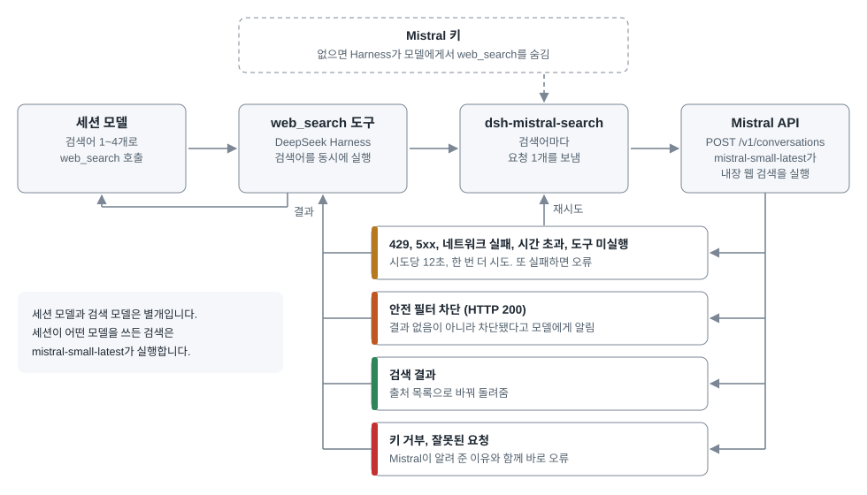

<h1 align="center">dsh-mistral-search<br>DeepSeek Harness에서<br>Mistral로 웹을 검색합니다.</h1>

<p align="center">
  DeepSeek Harness의 <code>web_search</code>를 Mistral 내장 웹 검색으로 처리하는 플러그인입니다.<br>
  검색에는 Mistral 키만 씁니다. DeepSeek 키와 Vibe 프로그램은 필요 없습니다.
</p>

<p align="center">
  DeepSeek이나 Mistral의 공식 프로젝트가 아닌 커뮤니티 플러그인입니다.
</p>

<p align="center">
  <a href="#업데이트와-제거"></a>
  <a href="LICENSE"></a>
</p>

<p align="center">
  <a href="#동작-구조">동작 구조</a> · <a href="#설치">설치</a> · <a href="#비용">비용</a> · <a href="#설정">설정</a> ·
  <a href="#제한">제한</a> · <a href="#업데이트와-제거">업데이트와 제거</a> · <a href="#확인한-범위">확인한 범위</a> · <a href="README.md">English</a>
</p>

## 동작 구조

<p align="center">
  
</p>

Mistral 문서에는 모델 없이 검색만 하는 API가 없습니다. 그래서 검색어마다 짧은 대화를 하나 보내고, 내장 웹 검색 도구가 찾은 결과를 가져옵니다.

검색어는 Mistral로 전송됩니다. `store: false`로 대화를 보관하지 말라고 요청합니다. 2026년 11월에 측정한 응답의 결과에는 `source: brave`가 표시됐습니다. Mistral이 검색어를 Brave Search로 넘기는 것으로 보이지만, 문서에는 나와 있지 않습니다.

## 설치

### 키 준비

Mistral 키를 `MISTRAL_VIBE_API_KEY`라는 이름으로 Harness 자격 증명 저장소에 넣거나, 실행 전에 환경 변수로 설정하세요. 다른 이름을 쓰려면 [`apiKeyEnv`](#설정)를 바꾸세요. 키가 없으면 Harness가 모델에게서 `web_search`를 숨깁니다.

### 웹판

```bash
dsh plugin --profile web add github:Burntgogi/dsh-mistral-search#v0.1.1
```

웹판을 다시 시작하세요.

### 데스크톱판

앱의 **플러그인 → 플러그인 추가**에 아래 주소를 넣으세요. 데스크톱 프로필은 앱이 관리하므로 `dsh plugin --profile desktop` 명령은 거부됩니다.

```text
https://github.com/Burntgogi/dsh-mistral-search#v0.1.1
```

## 비용

Mistral 웹 검색은 무료가 아닙니다. Mistral 문서에 따르면 모든 API 키는 조직의 플랜과 종량 과금 설정을 따릅니다. 월간 포함 사용량은 Studio, API, Vibe Code가 함께 쓰고 먼저 차감됩니다. 그 뒤로는 종량 과금이 켜져 있으면 선불 크레딧에서 차감되고, 꺼져 있으면 다음 결제 주기까지 사용이 멈출 수 있습니다. 플러그인은 이 설정을 읽지 못하므로 [API 키](https://docs.mistral.ai/admin/identity-access/api-keys)와 [구독](https://docs.mistral.ai/admin/billing-usage/subscriptions) 문서를 보고 직접 확인하세요.

`web_search` 한 번에 검색어를 최대 4개 보낼 수 있고, 검색어마다 따로 계산됩니다. 재시도하면 요청이 한 번 더 나갑니다. 2026년 11월의 적은 표본에서 검색어 하나는 보통 입력 약 800토큰, 검색 결과 5,000~8,500토큰, 출력 20~70토큰을 썼습니다. 이 플러그인이 플랜을 얼마나 쓰는지는 따로 재지 못했습니다.

## 설정

모두 선택 사항입니다. 프로필의 `cordis.patch.yml`에 적습니다.

```yaml
- id: dsh-mistral-search
  name: dsh-mistral-search
  config:
    model: mistral-small-latest
    apiKeyEnv: MISTRAL_VIBE_API_KEY
    baseURL: https://api.mistral.ai/v1
```

| 설정 | 의미 |
| --- | --- |
| `model` | 검색을 실행할 모델 |
| `apiKeyEnv` | 키가 저장된 이름. 키 자체를 적지 마세요 |
| `baseURL` | Mistral API 주소 |

내장 웹 검색을 받지 않는 모델도 있습니다. 2026년 11월에 Vibe 키로 측정한 결과, `mistral-small-latest`는 동작했고 `deepseek-v4-1-flash-1017`, `ministral-3b-latest`, `ministral-14b-latest`는 HTTP 400(code 3004)으로 거부됐습니다. 모델 카드와 다를 수 있습니다.

## 제한

- 정상적인 주제도 차단될 수 있습니다. 2026년 11월 시험에서 `prompt injection attack examples`, `OWASP LLM01 prompt injection mitigation`, `ignore previous instructions meme origin`이 차단됐으므로 이 주제를 조사하는 데는 맞지 않습니다. Mistral은 차단 기준을 밝히지 않으며, 다른 검색이 얼마나 자주 막히는지는 재지 않았습니다.
- 검색어 하나가 차단돼도 같은 호출의 다른 검색어는 실행됩니다. Harness가 출처를 한 목록으로 합치므로, 차단된 검색어 제목 아래에 다른 검색어의 출처가 보일 수 있습니다.
- 검색 카드에 `<strong>` 태그가 글자로 보일 수 있습니다. Mistral이 준 요약을 그대로 넘기기 때문입니다.
- 검색 엔진은 Mistral 하나입니다. 실패해도 다른 엔진으로 넘어가지 않습니다.
- 결과는 Mistral 문서에 없는 `info.result` 필드에서 읽습니다. 이 필드가 사라지면 인용 정보를 대신 쓰고, 그것도 없으면 빈 검색으로 처리하지 않고 오류를 냅니다.
- 플러그인은 자신을 `searchProvider`로 고정합니다. 끄기만 하고 고정을 남기면 검색이 `WEB_PROVIDER_CONFIGURED_MISSING`으로 실패합니다. Harness의 웹 검색 설정 스위치를 쓰면 이 값을 덮어쓰므로 `dsh-mistral-search`로 되돌리세요.

시도는 두 번까지 하고 시도당 12초로 제한합니다. 사이 대기는 최대 5초라서 모두 합쳐도 29초이고, Harness의 기본 도구 제한 시간인 30초 안에 끝납니다. 5초 넘게 기다리라는 응답은 재시도하지 않습니다. Mistral 모델이 요청과 다른 검색어를 쓰면 결과를 유지하고 그 사실을 모델에게 알립니다.

## 업데이트와 제거

DeepSeek Harness 0.2.2-rc.1만 지원합니다. 다른 버전에서는 설치가 거부됩니다. Harness를 새 버전으로 올리면 그 버전을 지원하는 릴리스가 필요합니다.

업데이트하려면 저장소 주소의 태그를 새 릴리스 태그로 바꿔 다시 추가하세요.

제거는 아래 명령으로 합니다. 데스크톱판은 **플러그인** 화면에서 제거하세요.

```bash
dsh plugin --profile web remove dsh-mistral-search
```

제거하면 플러그인이 추가한 `searchProvider` 고정도 사라집니다. 직접 저장한 값은 남으므로 직접 지워야 합니다.

## 확인한 범위

Windows 11, Node.js 24, DeepSeek Harness 0.2.2-rc.1에서 시험했습니다.

| 항목 | 방법 |
| --- | --- |
| 태그를 지정한 Git 설치, 번들 등록, 제거 | 로컬 저장소 주소, 격리 환경, 가짜 API |
| 키가 없을 때 도구 숨김, 재시도, 취소 | 같은 환경과 Harness 통합 시험 |
| 실제 검색, 차단 안내, `web_fetch` | Vibe 키, 웹판 |
| 실제 검색, 차단 안내 | Vibe 키, 데스크톱판 |

실제 검색은 런타임 폴더에 넣은 복사본으로 시험했습니다. `github:` 주소 설치와 데스크톱판 **플러그인 추가** 설치, Vibe 키가 아닌 키, macOS와 Linux는 시험하지 않았습니다.

코드는 `lib/search.js`와 `lib/index.js`에 있고, `npm test`는 설치 없이 오프라인으로 돕니다. 문제는 [이슈](https://github.com/Burntgogi/dsh-mistral-search/issues)로 알려 주세요.

## 라이선스

[MIT 라이선스](LICENSE) · Copyright (c) 2026 Burntgogi

DeepSeek과 DeepSeek Harness는 DeepSeek의 상표이고, Mistral은 Mistral AI의 상표입니다.
