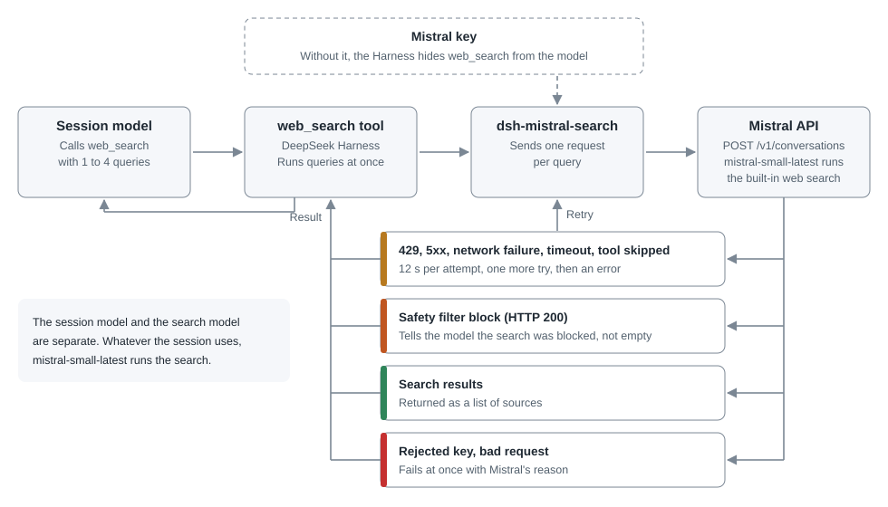

<h1 align="center">dsh-mistral-search<br>Web search for DeepSeek Harness,<br>through Mistral.</h1>

<p align="center">
  This plugin answers DeepSeek Harness <code>web_search</code> calls with Mistral's built-in web search.<br>
  Search uses only your Mistral key. You do not need a DeepSeek key or the Vibe program.
</p>

<p align="center">
  This is a community plugin, not an official DeepSeek or Mistral project.<br>
  Turning on web search carries a security risk. Read <a href="#security">Security</a> first.
</p>

<p align="center">
  <a href="#update-and-remove"></a>
  <a href="LICENSE"></a>
</p>

<p align="center">
  <a href="#how-it-works">How it works</a> · <a href="#security">Security</a> · <a href="#install">Install</a> · <a href="#cost">Cost</a> · <a href="#settings">Settings</a> ·
  <a href="#limits">Limits</a> · <a href="#update-and-remove">Update and remove</a> · <a href="#what-was-tested">What was tested</a> · <a href="README.ko.md">한국어</a>
</p>

## How it works

<p align="center">
  
</p>

Mistral documents no search API that works without a model. So the plugin sends one short conversation per query and takes the results that the built-in web search tool found.

Your search terms go to Mistral. `store: false` asks Mistral not to keep the conversation. Responses measured in November 2026 label their results with `source: brave`, which suggests Mistral passes queries on to Brave Search. Mistral does not document this.

## Security

Turning on web search always carries a security risk. Search results come from web pages that anyone can write, and a page can hold instructions that trick the model (prompt injection). Mistral's safety filter or the search engine may remove some of this, but you cannot rely on them to remove all of it.

- The risk is highest in a full access session. A tricked model can run commands without approval and read anything your account can read, including the Mistral key and other credentials. Use a permission that asks for approval, such as workspace write. The risk does not go away under that permission.
- The model can put your work into search terms, and search terms go to Mistral. Turn the plugin off for sensitive work.
- A tricked model can repeat searches and use up your allowance. The plugin has no limit on the number of searches. If pay-as-you-go is on, this can reach your prepaid credits.
- If you think the key has leaked, issue a new one at Mistral.

## Install

### Prepare a key

Store your Mistral key as `MISTRAL_VIBE_API_KEY` in the Harness credential store, or set it as an environment variable before launch. To use another name, change [`apiKeyEnv`](#settings). Without a key, the Harness hides `web_search` from the model.

### Web

```bash
dsh plugin --profile web add github:Burntgogi/dsh-mistral-search#v0.1.1
```

Restart the web server.

### Desktop

In the app, open **Plugins → Add plugin** and enter the address below. When the install finishes, press **Enable now**. The app manages the desktop profile, so `dsh plugin --profile desktop` is refused.

```text
https://github.com/Burntgogi/dsh-mistral-search#v0.1.1
```

## Cost

Mistral's web search is not free. Mistral states that every API key uses your organization's plan and pay-as-you-go settings. Included monthly usage is shared across Studio, the API and Vibe Code and is used first. After that, usage draws on prepaid credits if pay-as-you-go is on, and can stop until the next billing period if it is off. The plugin cannot read these settings, so check them yourself in the [API keys](https://docs.mistral.ai/admin/identity-access/api-keys) and [Subscriptions](https://docs.mistral.ai/admin/billing-usage/subscriptions) documents.

One `web_search` call can hold up to 4 queries, and each query counts separately. A retry sends a second request. In a small sample from November 2026, a query usually took about 800 input tokens, 5,000 to 8,500 search result tokens and 20 to 70 output tokens. This plugin's share of plan usage has not been measured in isolation.

## Settings

All settings are optional. Set them in your profile's `cordis.patch.yml`.

```yaml
- id: dsh-mistral-search
  name: dsh-mistral-search
  config:
    model: mistral-small-latest
    apiKeyEnv: MISTRAL_VIBE_API_KEY
    baseURL: https://api.mistral.ai/v1
```

| Setting | Meaning |
| --- | --- |
| `model` | The model that runs the search |
| `apiKeyEnv` | The name that holds the key. Never write the key itself |
| `baseURL` | The Mistral API address. The key is sent to it, so only HTTPS is accepted. HTTP is allowed on localhost only |

Some models do not accept the built-in web search. Measured in November 2026 with a Vibe key, `mistral-small-latest` worked, and `deepseek-v4-1-flash-1017`, `ministral-3b-latest` and `ministral-14b-latest` were refused with HTTP 400 (code 3004). Model cards can differ from this.

## Limits

- Legitimate topics can be blocked. In November 2026, `prompt injection attack examples`, `OWASP LLM01 prompt injection mitigation` and `ignore previous instructions meme origin` were blocked, so this plugin is a poor fit for research on that subject. Mistral does not say what triggers the block, and how often other searches are blocked was not measured.
- When one query is blocked, the other queries in the call still run. The Harness merges sources into one list, so another query's sources can appear under the blocked query's heading.
- Search cards can show `<strong>` tags as text, because the plugin passes on Mistral's summary unchanged.
- Mistral is the only engine. A failed search does not move to another engine.
- Results come from `info.result`, a field Mistral does not document. If it goes away, the plugin uses citation chunks. If those are also missing, the plugin reports an error and does not treat the search as empty.
- The plugin pins itself as `searchProvider`. If you disable it but keep the pin, searches fail with `WEB_PROVIDER_CONFIGURED_MISSING`. The Harness web search settings switch overwrites this value, so set it back to `dsh-mistral-search` if you use the switch.

The plugin makes at most two attempts, each limited to 12 seconds. The wait between them is at most 5 seconds, so the total is at most 29 seconds, within the Harness's default 30-second tool limit. A response that asks for a wait longer than 5 seconds is not retried. If Mistral's model searches with different terms, the plugin keeps the results and tells the session model.

## Update and remove

Only DeepSeek Harness 0.2.2-rc.1 is supported. Other versions refuse the install. If you move the Harness to a new version, you need a release that supports it.

To update, add the plugin again with the new release tag in the address.

To remove it, run the command below. In the desktop app, remove it from the **Plugins** screen.

```bash
dsh plugin --profile web remove dsh-mistral-search
```

Removing the plugin removes the `searchProvider` pin it added. A value you saved yourself stays, and you must clear it by hand.

## What was tested

Tests ran on Windows 11, Node.js 24 and DeepSeek Harness 0.2.2-rc.1.

| Item | Method |
| --- | --- |
| Install from `github:`, HTTPS and Release `.tgz` addresses, bundle registration, removal | Public repository, web profile, isolated home |
| Install from the desktop **Add plugin** screen, enabling, Running status | Public repository, isolated home, no key |
| Hiding the tool without a key, retry, cancel | `github:` install, isolated home, fake API, plus a Harness integration test |
| Real search, block notice, `web_fetch` | Vibe key, web |
| Real search, block notice | Vibe key, desktop |

Real searches used a copy placed in the runtime folder. No real Mistral search has run on a package installed from the public repository. Keys other than a Vibe key, macOS and Linux were not tested.

The code is in `lib/search.js` and `lib/index.js`. `npm test` runs offline and needs no install. Report problems in [Issues](https://github.com/Burntgogi/dsh-mistral-search/issues).

## License

[MIT License](LICENSE) · Copyright (c) 2026 Burntgogi

DeepSeek and DeepSeek Harness are trademarks of DeepSeek. Mistral is a trademark of Mistral AI.
